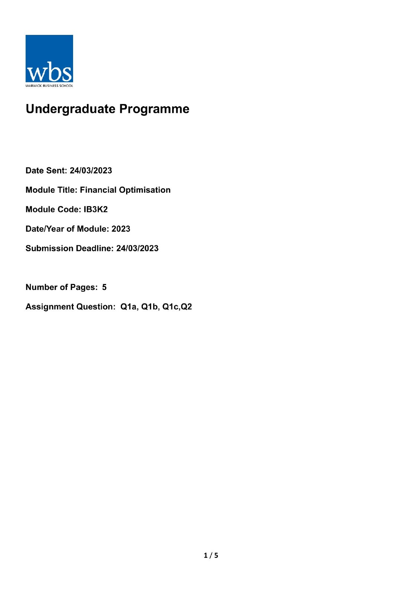
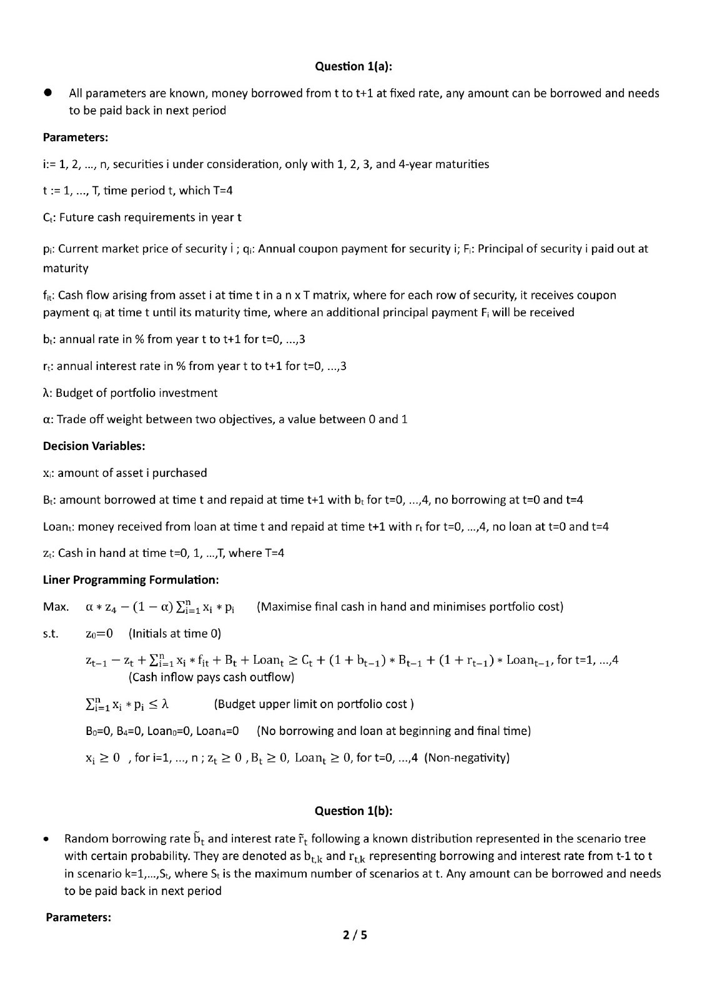
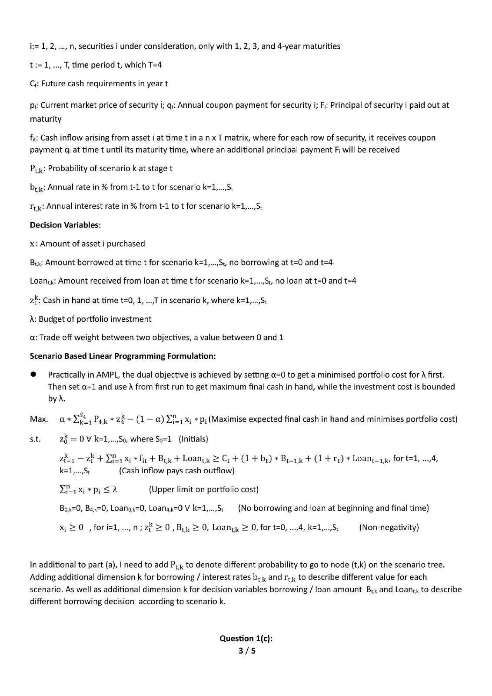
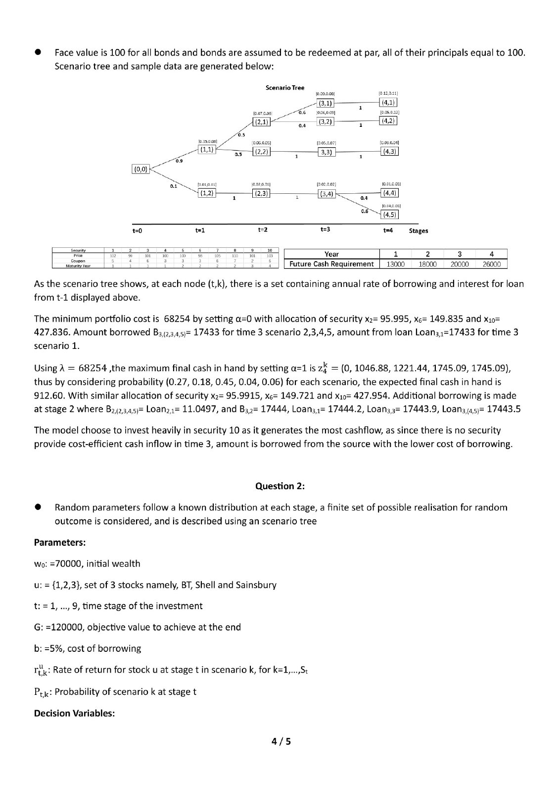
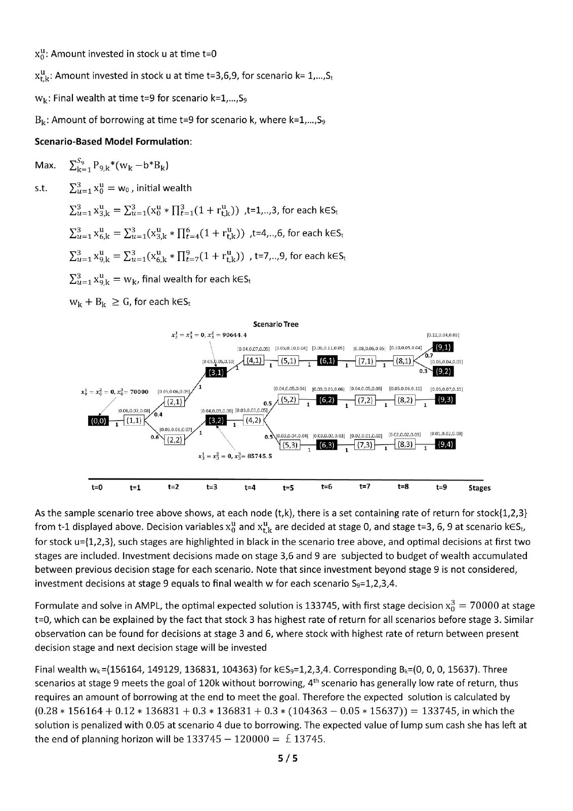

# Individual assignment (2022/23)

This is a page-by-page preview of my five-page IB3K2 Financial Optimisation submission. The preview images were made from the redacted PDF in this folder; the student number and the original PDF author metadata are not included.

GitHub's built-in PDF preview may sometimes show **Unable to render**. If that happens, read the pages below or use **Download raw file** on [the PDF page](IB3K2-2023-submission-redacted.pdf) to open it in a PDF reader.

The accompanying `Q1c` and `Q2` AMPL `.mod`, `.dat`, and `.run` files are preserved exactly as submitted. The report's mathematical content and results have not been revised.

## Page 1

## Page 2

## Page 3

## Page 4

## Page 5

